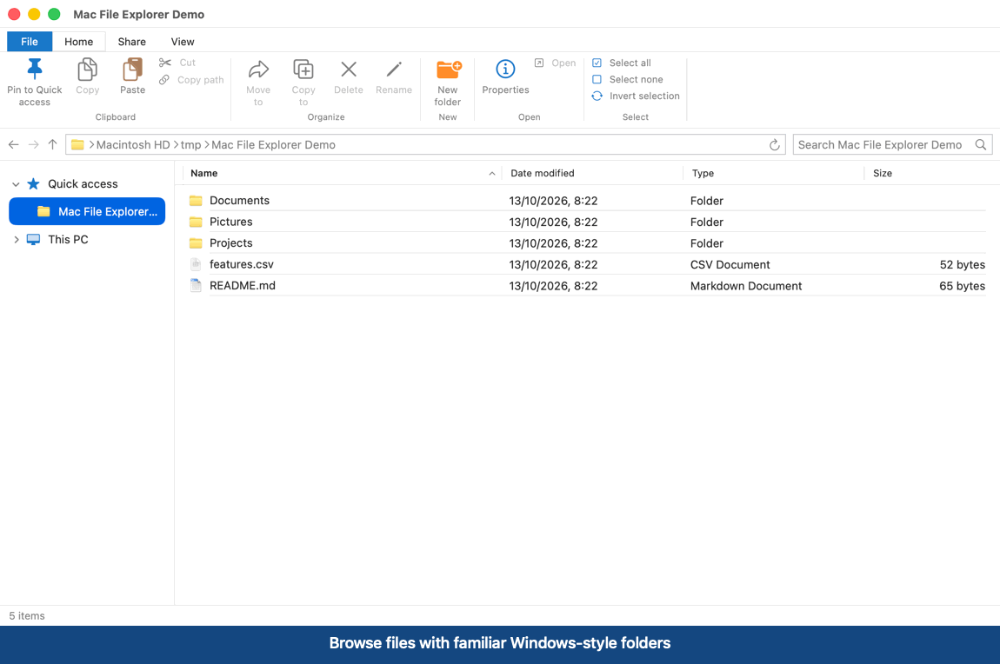

# Windows Style Mac Explorer

A native macOS file manager inspired by Windows 10 File Explorer. It brings the ribbon, breadcrumb address bar, navigation pane, yellow folders, preview pane, and familiar file operations to macOS.



[Download the MP4 walkthrough](assets/demo.mp4)

## Features

- Home, Share, and View ribbon tabs
- Back, forward, up, refresh, breadcrumbs, and path entry
- Quick access pins and a collapsible “This PC” navigation pane
- Search and sortable Name, Date modified, Type, and Size columns
- Quick Look preview pane and file properties
- New folder, rename, cut, copy, paste, move, trash, and zip
- Hidden-file and file-extension toggles
- Native macOS file icons recolored to Windows-style yellow folders

## Requirements

- macOS 14 or later
- Swift 6 toolchain, available with Xcode or Apple Command Line Tools

## Run

```bash
git clone https://github.com/rnjsxodyd90/windows-style-mac-explorer.git
cd windows-style-mac-explorer
swift run
```

## Test

```bash
swift test
```

## Keyboard shortcuts

- `⇧⌘N` — New folder
- `⌘X`, `⌘C`, `⌘V` — Cut, copy, and paste
- `F2` — Rename
- `⌘I` — Properties
- `⌘[`, `⌘]` — Back and forward
- `⌘↑` — Up one folder
- `⌘R` — Refresh
- `Delete` — Move selected items to Trash

## Project status

Windows Style Mac Explorer is an early native SwiftUI implementation. File operations currently run synchronously, so very large copies may temporarily block the interface.

Contributions and bug reports are welcome.

## License

[MIT](LICENSE)
